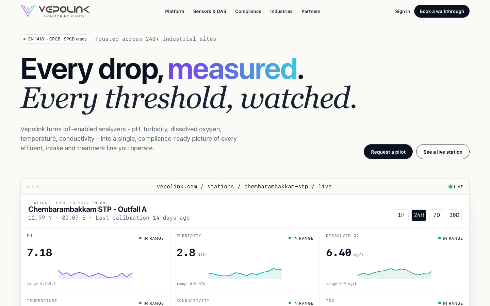

# Vepolink Website

Static, server-rendered HTML/CSS/JavaScript marketing website for `vepolink.com`.



## Technology

- Static server-rendered HTML in `index.html`
- Clean static pages in `/water-quality-monitoring/`, `/about/`, and `/products/multi-paramater-online-water-analyzer/`
- CSS-only responsive layout and visual system in `assets/site.css`
- Small vanilla JavaScript enhancement layer in `assets/site.js`
- Precompiled React bundle for the richer about page in `assets/about.bundle.js`
- Retired product-page files are preserved in `_preserved/old-product-page/` for later reuse and excluded from deploy sync
- No build step required for local preview
- Can be hosted on any static hosting provider

## Features

- SEO-ready static content for important above-the-fold and section content
- Schema.org `Organization` and `WebSite` structured data
- Product schema on the product detail page
- Open Graph and Twitter card metadata
- `robots.txt` and `sitemap.xml`
- Responsive desktop and mobile layouts
- Lightweight dashboard visuals with client-side metric updates
- Content Security Policy and deployment headers in `_headers`
- Local assets for logos and favicon
- Branded `404.html` page for missing routes, configured as the CloudFront custom error response

## Run Locally

From the project folder:

```bash
cd /Users/anantmendiratta/Dev/Vepolink-website
python3 -m http.server 4173
```

Open:

```text
http://localhost:4173/
http://localhost:4173/water-quality-monitoring/
http://localhost:4173/about/
http://localhost:4173/products/multi-paramater-online-water-analyzer/
```

To stop the local server, press `Ctrl+C` in the terminal running the server.

## Alternative Preview

Because this is a static site, you can also open `index.html` directly in a browser:

```text
file:///Users/anantmendiratta/Dev/Vepolink-website/index.html
```

Using the local server is preferred because it behaves closer to production.

## Water probe catalog

The category lives at `/products/water-monitoring-probes/`. Reviewed catalog records and image mappings are in `content/water-probes.json`; source conflicts and publication decisions are documented in `docs/water-probes-content.md`.

The 18 child-page records are in `content/water-probe-details.json`, with the reviewed Advance Analytik source evidence in `docs/sources/water-probes/advance-analytik.json`. The user’s draft PDF is superseded.

Category cards are selection summaries with prominent links to individual probe pages. Their output/range labels use the child records so analog and digital specifications stay distinct. Search and output filters hide individual non-matching options; all 18 links remain available without JavaScript. Full technical information and probe-specific enquiries live on the child pages.

After changing the records or page templates, run `node scripts/render-water-probe-pages.js`, `node scripts/render-water-probes.js`, then `node scripts/render-shared.js` to keep the static page and shared navigation synchronized. The catalog is fully readable without JavaScript; `assets/water-probes.js` enhances search, output filtering and deep links. Validate with `node --test scripts/water-probes.test.js scripts/water-probe-pages.test.js`. Both the category and child pages are statically rendered. The detail-page generator also updates sitemap entries for all sensor routes.

## Deploy Notes

Upload only the public static output using the exclusions in `deploy/aws-s3-cloudfront.md`. Build records, supplier source documents, image-provenance sidecars, scripts and design notes are internal and must not be published. Public instrument names, links and documents use Vepolink branding only. Make sure the deploy platform applies the headers in `_headers`, especially the Content Security Policy and `frame-ancestors` directive.
